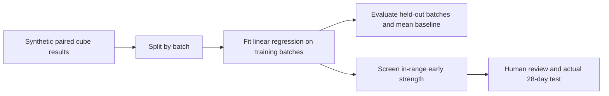

# Concrete Cube Strength Predictor

[](https://github.com/TusharSrivastava751/concrete-cube-strength-predictor/actions/workflows/tests.yml)

> **Public reconstruction based on a CV project concept.** New implementation prepared
> with AI assistance, using only synthetic data. Original workplace code and datasets
> were not available. See [provenance](PROVENANCE.md). This demo does not substantiate
> historical productivity savings or production performance.

Demonstrate a reproducible **7-day to 28-day cube-strength regression** with
scikit-learn, batch-separated evaluation and explicit screening limits.

The CV project describes linear regression used to flag potential 28-day strength
failures from early results. This public reconstruction estimates a continuous
strength and compares it with a user-supplied **demonstration screening target**.
It does not produce a calibrated failure probability or an acceptance decision.



## What you can inspect

- 80 original synthetic sample pairs across 40 batches; the generation rule is open.
- One feature: 7-day cube strength in MPa. Target: 28-day cube strength in MPa.
- 30 training batches and 10 test batches, seed 42; no batch appears in both.
- MAE/RMSE, a training-mean baseline, every test prediction and source fingerprint.
- Refusal to extrapolate outside the observed training feature range.
- A test proving that changing held-out target values does not change fitted parameters.

## Run locally

Use Python 3.11 or newer. Download this repository with **Code → Download ZIP** and
extract it. Open a terminal in the extracted folder. On macOS/Linux, use `python3`
if `python` is unavailable.

```bash
python -m venv .venv
# macOS / Linux:
source .venv/bin/activate
# Windows PowerShell instead:
# .venv\Scripts\Activate.ps1
python -m pip install -r requirements.txt
```

The direct dependencies are pinned. Transitive packages are resolved by pip; this is
not a fully locked environment. No API key, paid model or network call is needed once
dependencies are installed. Use a **new output directory** for each run.

```bash
python strength_model.py data/synthetic_cube_results.csv --early 24 --target 40 --out reports
python -m unittest discover -s tests -v
```

Read `reports/report.md` and `reports/evaluation.json`.
[Checked report](examples/expected/report.md) ·
[Full evaluation](examples/expected/evaluation.json) ·
[Data card](data/DATA-CARD.md)

## Demonstration results

On the included synthetic fixture, held-out MAE is **2.868 MPa**, RMSE **3.681 MPa**,
and training-mean baseline MAE **11.776 MPa**. An early result of 24 MPa produces a
prediction of approximately **37.02 MPa**, below the illustrative 40 MPa target.
These are measured synthetic-demo results, not site validation or the CV project's
historical results. Tiny numerical differences may occur across library platforms.

## Why these limits matter

The synthetic relationship is deliberately learnable and was invented for software
demonstration. It cannot establish real concrete behaviour. Mix design, cement type,
curing, specimen geometry, sampling and laboratory practice are absent. Two paired
records from one batch stay together during evaluation, but a random batch split
does not test future-site or future-mix performance.

The target is entered explicitly; the program does not infer a cube target from a
grade name. Cube and cylinder strengths are not interchangeable here. No structural
release, formwork-striking, compliance or acceptance decision should use this demo.
Actual tests and the applicable project QA process remain necessary.

There are no calibrated prediction intervals or classification precision/recall
claims. Before a real pilot, obtain authorised representative data, define the
sampling unit and target with a qualified reviewer, reserve an independent temporal/
site/mix validation set, assess false negatives and uncertainty, and monitor drift.

## Interview exercise

Explain why target leakage can make a model look excellent, why two cube pairs from
one batch should not be split across train/test, and why a good synthetic MAE is not
evidence of deployment readiness. Try `--early 100` to see explicit abstention.

## References

- [scikit-learn LinearRegression](https://scikit-learn.org/stable/modules/generated/sklearn.linear_model.LinearRegression.html)
- [GroupShuffleSplit](https://scikit-learn.org/stable/modules/generated/sklearn.model_selection.GroupShuffleSplit.html)
- [Common ML pitfalls](https://scikit-learn.org/stable/common_pitfalls.html)

MIT licensed. No actual cube reports or production model weights are included.
